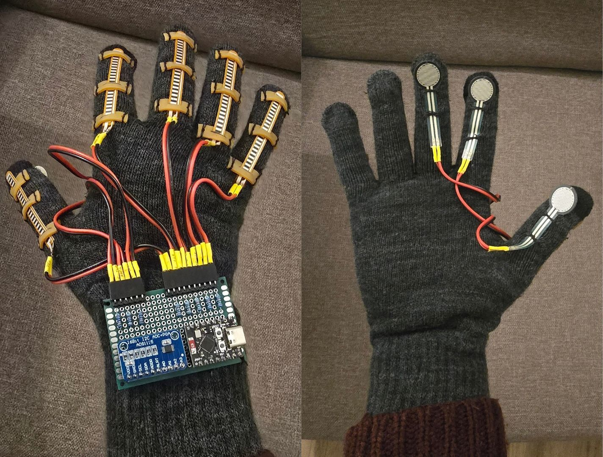
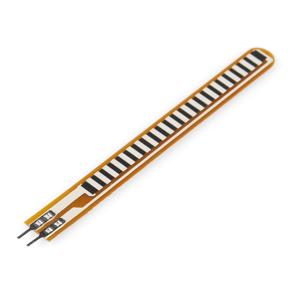
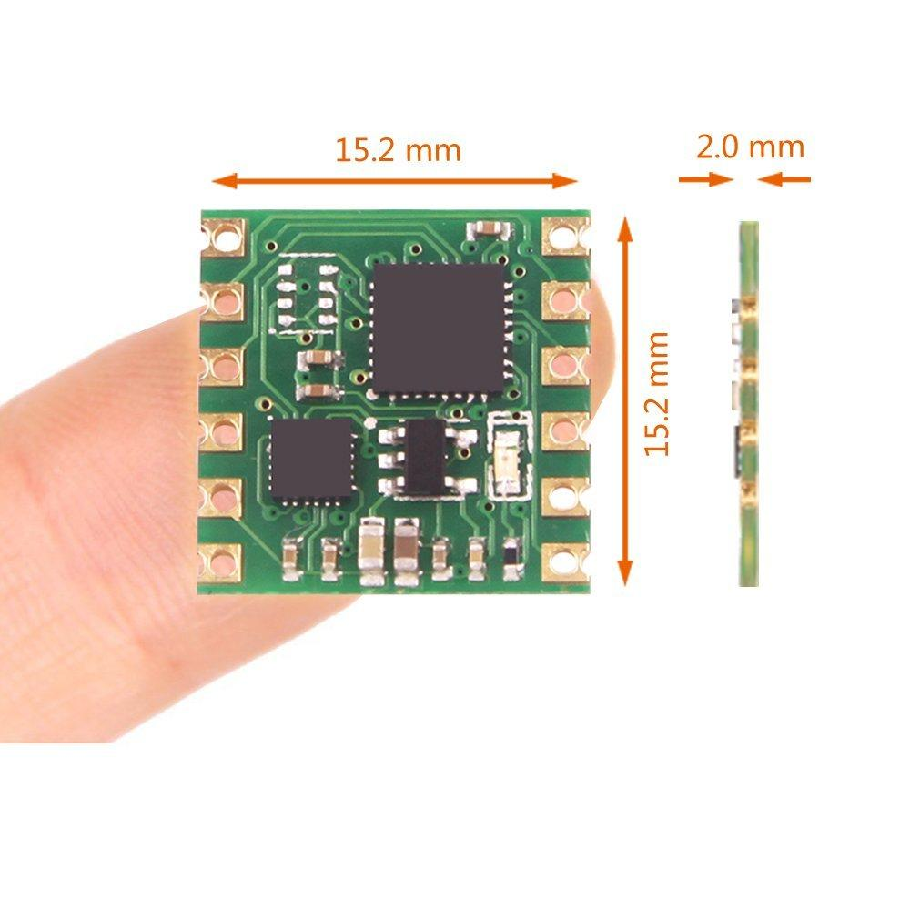
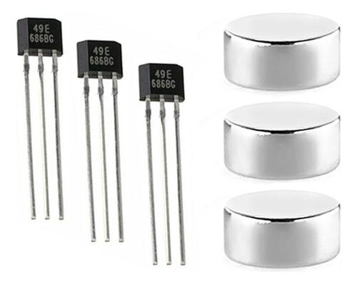
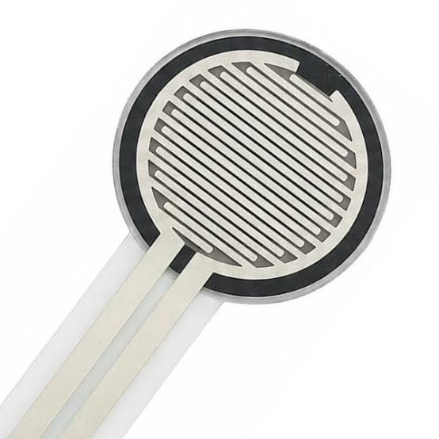
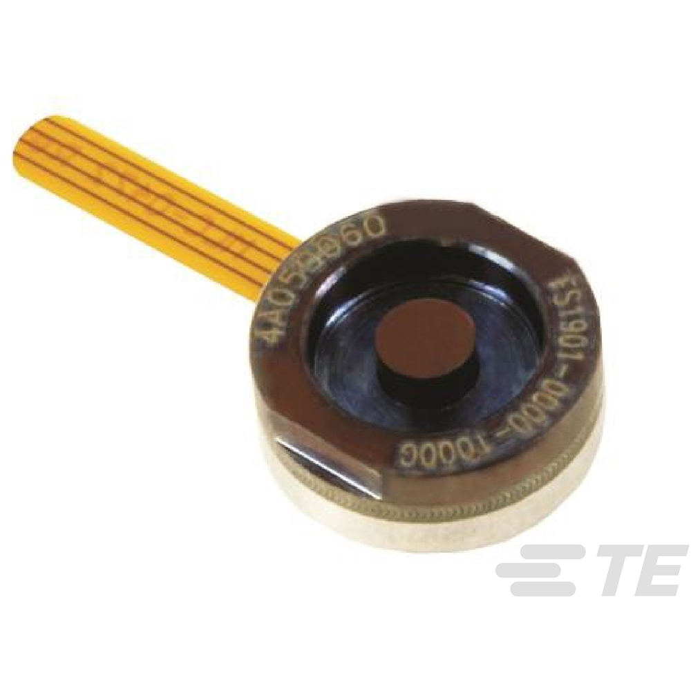
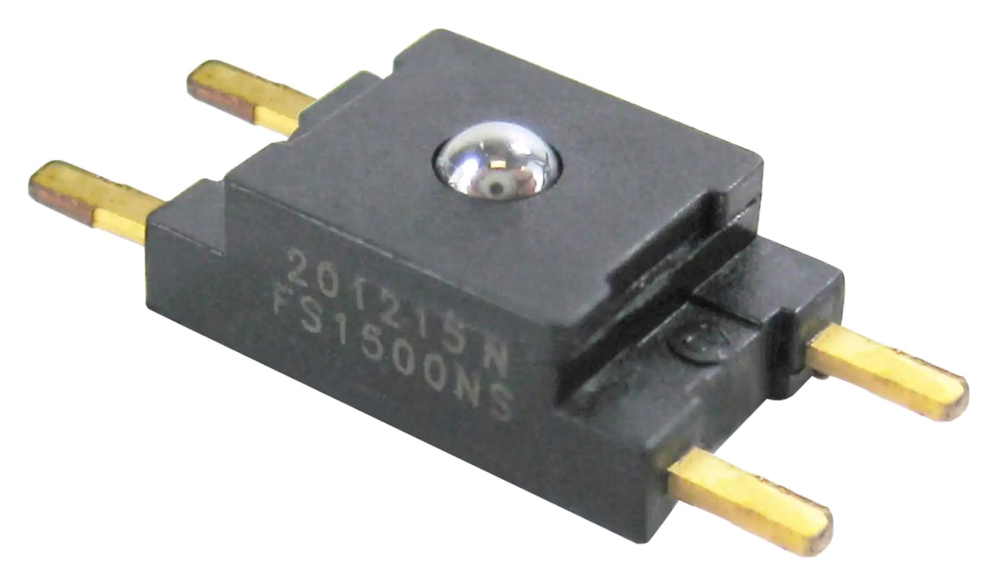
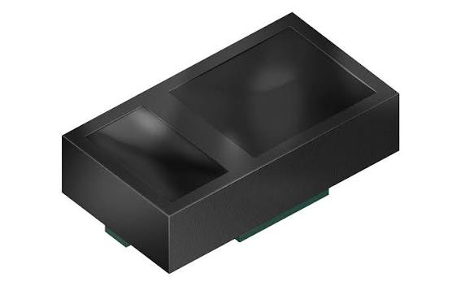
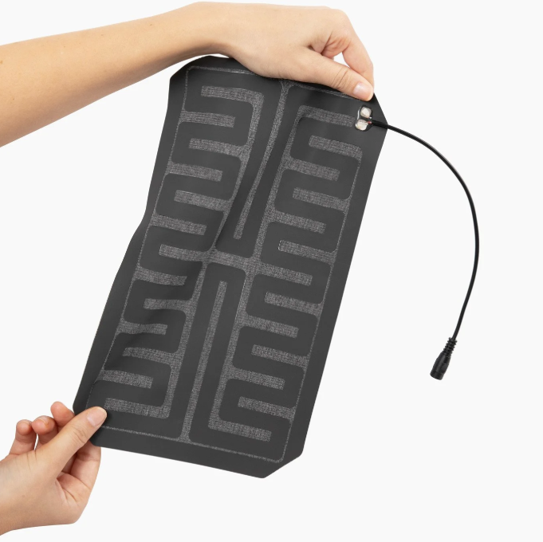
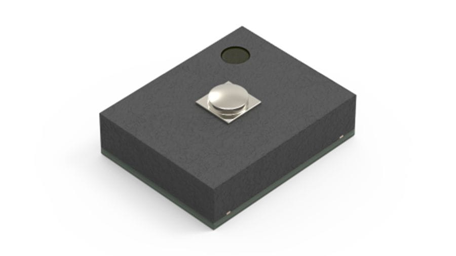

# Medical Hand Assist Glove

This is an ongoing personal R&D project aimed at developing a wearable glove to monitor finger movement and contact-force sensing for hand rehabilitation.

The first prototype uses flex sensors, an ESP32-C3, and a real-time 3D hand visualization. I'm currently working on integrating and testing the force sensors and improving the mechanical design.

I'll keep updating this repository as the project develops.

## 1. Introduction

This project started from a request by physiotherapy professionals who were looking for a way to obtain measurable feedback on hand movement during rehabilitation, particularly for patients recovering from stroke or other neurological conditions.

The idea is to develop a wearable glove that can monitor how well a patient can bend and extend their fingers, and eventually assess their ability to apply force while holding an object.

The current prototype focuses on finger-motion tracking and real-time 3D visualization. Contact-force sensing is being integrated as the next development step.

The longer-term goal is to collect consistent measurements that can help physiotherapists compare hand function between treatment sessions.

## 2. From Clinical Needs to Engineering Requirements

Before selecting sensors or designing the electronics, I first translated the physiotherapists' needs into quantities that the system could measure.

The two main questions were:
- Can the patient move and control individual fingers?
- Can the patient apply force while grasping an object?

| Clinical need | Quantity to be measurement | Proposed approach |
|---|---|---|
| Assess finger bending and extension | Relative finger flexion | Five flex sensors, one per finger |
| Observe individual finger control | Independent finger response | Five sensor channels and 3D visualization |
| Assess interaction with a held object | Contact-force response | Three mechanically installed force sensors; electrical testing pending |
| Monitor rehabilitation progress | Repeatable measurements across sessions | Planned after sensor characterization and data logging |

For the first prototype, I focused on demonstrating finger-motion sensing and the integration of the wearable system. Reliable force measurement and longitudinal progress tracking are objectives for the next development stages.

## 3. Sensor Technology Investigation

Before selecting the sensors, I divided the measurement requirements into two main groups:

1. **Finger motion sensing:** Detecting the bending and extension of individual fingers.
2. **Contact-force sensing:** Detecting the force-related response when the fingers press against or hold an object.

For both groups, I considered different sensing technologies based on their working principles, mechanical integration, signal acquisition requirements, cost, and suitability for a wearable device.

The goal at this stage was not to find the most accurate sensor available, but to select a practical sensing approach for the first prototype and identify which technologies deserve further investigation.

### 3.1 Finger Motion Sensing

**Candidate 1 — Resistive Flex Sensors**

*Advantages:*
- Thin, flexible construction suitable for mounting along the fingers.
- Simple resistance-based measurement using a voltage divider.
- Straightforward integration with a microcontroller.
- Relatively low cost and suitable for rapid prototyping.

*Limitations:*
- Nonlinear resistance-to-bending response.
- Sensitive to mounting position and mechanical strain.
- Repeatability and long-term stability require investigation.
- A single sensor cannot independently measure every finger-joint angle.

**Decision:** Selected for the initial prototype to investigate relative finger flexion with minimal electronic complexity.

**Candidate 2 — IMU-Based Sensing**

*Advantages:*
- Provides acceleration and angular-motion information.
- Can support dynamic movement analysis and hand-orientation tracking.
- Offers additional possibilities for future motion assessment.

*Limitations:*
- Individual finger tracking may require multiple sensing units.
- Relative joint-angle estimation requires additional processing and calibration.
- Sensor placement, wiring, power consumption, and mechanical integration increase system complexity.

**Decision:** Not selected for initial finger-flexion sensing. IMUs remain candidates for a later development stage, particularly for hand and wrist motion assessment.

**Candidate 3 — Magnetic Sensing (Hall-Effect / Magnetic Position Sensing)**

*Advantages:*
- Contactless measurement principle.
- Potential for compact sensor integration.
- Can detect relative movement through changes in magnetic field.

*Limitations:*
- Requires careful positioning of magnets and sensing elements.
- Sensitive to alignment and distance variations.
- Magnetic interference and finger-to-finger interactions need consideration.

**Decision:** Deferred because of the additional mechanical integration and calibration requirements.

### 3.2 Contact-Force Sensing

For the contact-force measurement, I considered several technologies with different trade-offs between sensing performance, package dimensions, mechanical integration, and signal-conditioning requirements.

**Candidate 1 — FSR 402 (Force-Sensitive Resistor)**

*Advantages:*
- Thin and lightweight sensing element.
- Relatively easy integration onto a fabric glove.
- Simple analog interfacing.
- Low development cost for initial experiments.

*Limitations:*
- Nonlinear force-to-resistance relationship.
- Response depends on contact geometry and load distribution.
- Hysteresis, drift, and repeatability require characterization.
- Requires calibration before meaningful force values can be reported.

**Decision:** Selected for the first prototype because of its mechanical simplicity and suitability for investigating contact-force sensing feasibility.

Three sensors have been mechanically installed. Electrical integration and force-response testing are part of the next development stage.

**Candidate 2 — TE Connectivity FS1901-0000-0500-G**

*Technology: Miniature compression load cell — 5 N nominal range.*

*Advantages:*
- Designed for force measurement with a specified measurement range.
- Suitable for controlled compression-force applications.
- Attractive candidate for quantitative force measurement.

*Limitations:*
- Minimum load detection is relatively higher than human finger force.
- Less straightforward integration into a flexible textile glove.
- Low-level output requires suitable signal conditioning.
- Higher integration complexity for the current prototype.

**Decision:** Not selected.

**Candidate 3 — Honeywell FSS005WNSB**

*Technology: Low-profile piezoresistive force sensor — 0–5 N.*

*Advantages:*
- Compact sensing package.
- Defined force-measurement range.
- Suitable for applications requiring localized force measurements.

*Limitations:*
- Minimum load detection is relatively higher than human finger force.
- Requires careful mechanical load transfer to the sensing element.
- Bridge-based output requires appropriate measurement electronics.
- Integrating a rigid sensing package into a moving fingertip presents mechanical challenges.

**Decision:** Not selected.

**Candidate 4 — ams OSRAM SFH 7065**

*Technology: Optical force-sensing front-end.*

*Advantages:*
- Very small package.
- Optical sensing approach that may support compact wearable integration.
- Interesting alternative to conventional resistive sensing.

*Limitations:*
- Does not measure force directly without a suitable mechanical and optical arrangement.
- Requires additional optical readout electronics.
- Needs investigation of displacement-to-force calibration, mechanical integration, and environmental sensitivity.

**Decision:** Kept as a research candidate for future investigation rather than immediate integration.

**Candidate 5 — Flexible Pressure-Sensing Films / Textiles**

*Advantages:*
- Potential for conformable sensing surfaces.
- Possibility of distributing sensing locations across the glove.
- Promising for future wearable and tactile-sensing applications.

*Limitations:*
- Sensor behavior depends strongly on the specific material and construction.
- Mechanical integration, calibration, drift, and signal readout require investigation.
- Performance and cost must be evaluated using specific candidate products.

**Decision:** Technology category retained for future research. No specific sensing film has been selected or experimentally evaluated yet.

**Candidate 6 — Alps Alpine HSFPAR004A**

*Technology: Miniature piezoresistive force sensor (0–8 N).*

*Advantages:*
- Extremely compact package (2.0 × 1.6 × 0.66 mm), potentially suitable for localized fingertip sensing.
- High sensitivity and specified linearity.
- Analog voltage output.
- Designed for repeated mechanical loading.

*Limitations:*
- Requires a carefully designed mechanical interface to transfer contact force to its small sensing area.
- Sensitive to load alignment and mechanical mounting conditions.
- Requires suitable signal conditioning and calibration.
- Integration into a flexible textile glove would require additional mechanical development.

**Decision:** Retained as a promising candidate for future evaluation. Its compact dimensions and defined force range are attractive, but the mechanical loading arrangement and measurement performance must be evaluated before considering integration.

**Technical References:**

- [FSR 402 — Interlink Electronics Datasheet](https://www.interlinkelectronics.com/downloads/datasheets/fsr-400-series-datasheet.pdf)
- [FS1901 — TE Connectivity Datasheet](https://www.te.com/en/product-FS1901-0000-0500-G.html)
- [FSS005WNSB — Honeywell Datasheet](https://prod-edam.honeywell.com/content/dam/honeywell-edam/sps/siot/en-us/products/sensors/force-sensors/fss-series/documents/sps-siot-force-sensors-fss-product-sheet-080809-2-en-ciid-50137.pdf)
- [SFH 7065 — ams OSRAM Datasheet](https://ams-osram.com/products/multi-chips/optical-modules/osram-optical-force-sfh-7065)
- [HSFPAR004A — Alps Alpine Datasheet](https://tech.alpsalpine.com/cms.media/product_spec_hsfpar004a_en_4cd4213172.pdf)
- [Flex Sensor — Spectra Symbol Specifications](https://www.spectrasymbol.com/resources/sensor-info-downloads)

### 3.3 Initial Sensor Selection

Based on the first-stage requirements, I selected two sensing technologies:

  

| Measurement | Initial selection | Main reason |
|---|---|---|
| Finger motion | 5 resistive flex sensors | Simple bending-sensitive interface and practical wearable integration |
| Contact force | 3 FSR 402 sensors | Thin construction and straightforward mechanical integration |

This combination provides a practical starting point for developing the sensing architecture and testing the mechanical and electronic integration.

The flex-sensing and real-time visualization functions have been implemented and demonstrated. The FSR sensors have been mechanically installed, with electrical testing planned next.

**The initial sensor selection is not considered final.** The next development iterations will focus on evaluating actual measurement performance, identifying limitations, and deciding whether the selected technologies remain suitable or should be replaced.

The alternative technologies described above are engineering candidates, not a claim that all sensors have been physically tested or rejected through experimental comparison.
