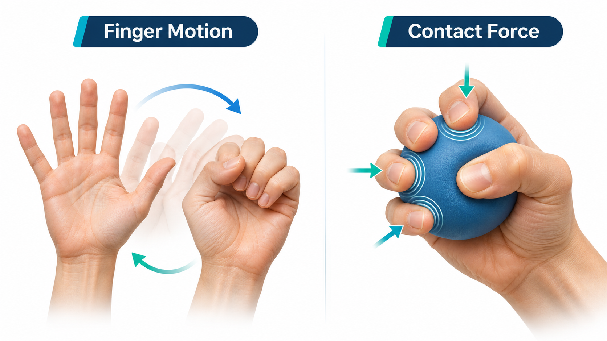
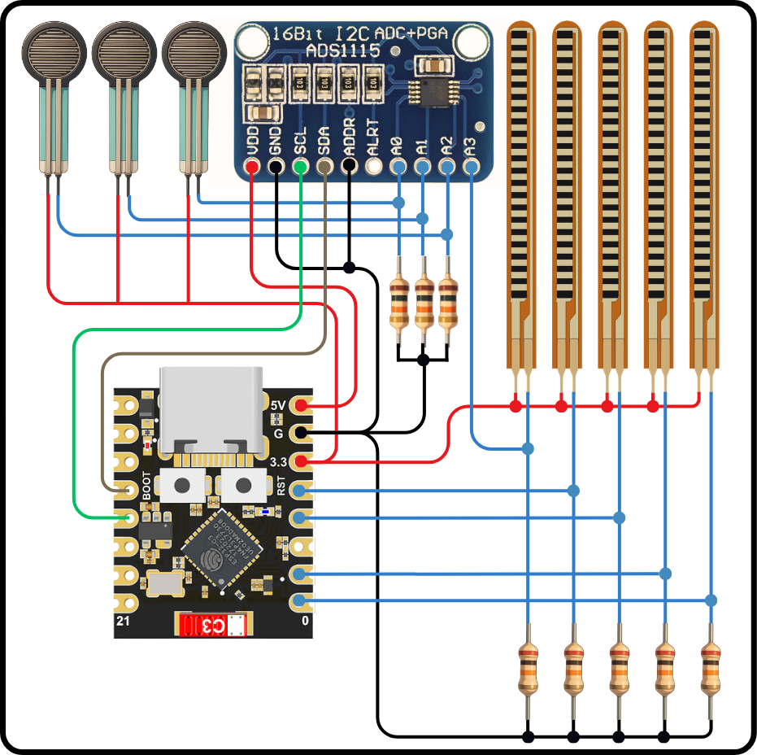
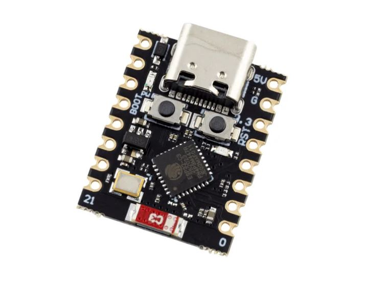
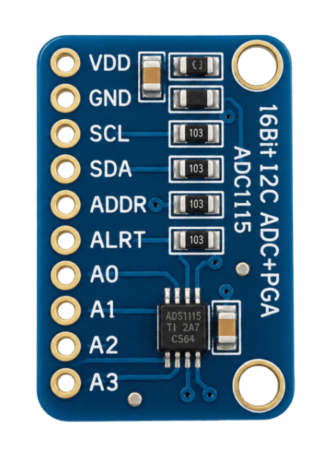
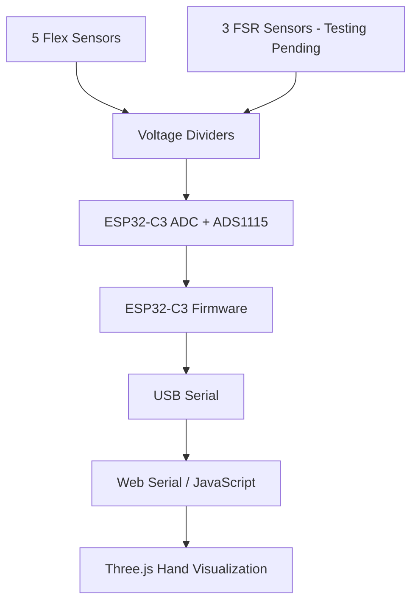
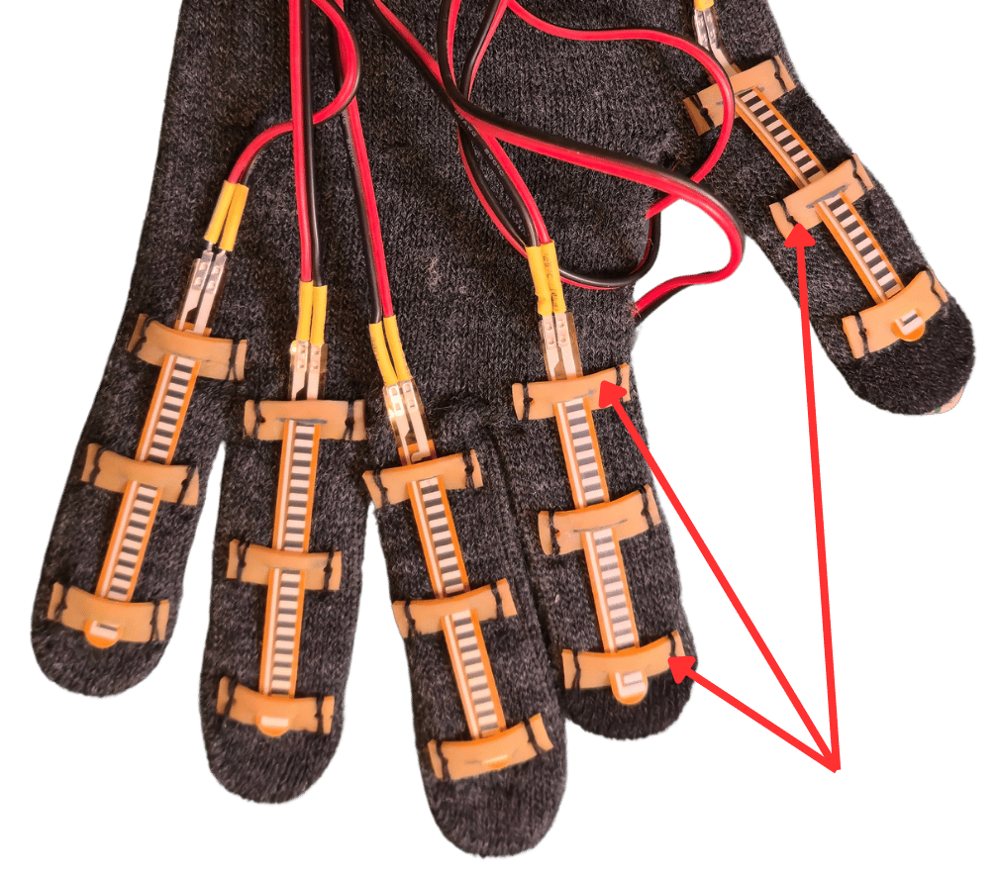
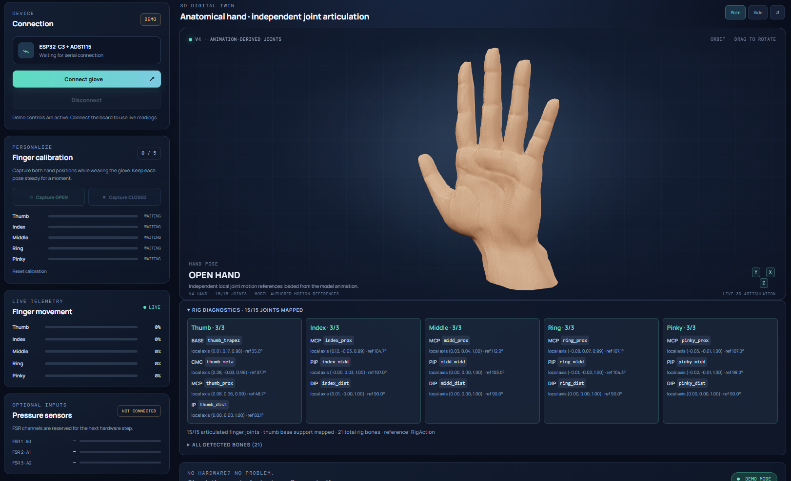

# Medical Hand Assist Glove

**An ongoing mechatronics R&D project for hand rehabilitation monitoring.**

[Watch the prototype demonstration](https://youtu.be/xcPXu10T4b0)

## 1. Project Overview

This project started from a request by physiotherapy professionals looking for a way to obtain measurable feedback on hand function during rehabilitation, particularly for patients recovering from stroke or neurological conditions.

The idea is to develop a wearable glove that can track individual finger movements and eventually measure contact force during grasping exercises. The long-term goal is to help physiotherapists monitor changes in hand function between treatment sessions.

**Current status:** The first prototype demonstrates real-time finger-motion tracking and 3D visualization. Three contact-force sensors have been mechanically installed, with electrical testing still in progress.

## 2. From Clinical Needs to Engineering Requirements

Before selecting the hardware, I translated the clinical needs into physical quantities that could be measured.

| Clinical need | Measurable quantity | Approach |
|---|---|---|
| Assess finger movement | Relative finger flexion | 5 flex sensors |
| Observe finger control | Independent finger response | Individual sensor channels |
| Assess grasping ability | Contact-force response | FSR sensors |
| Monitor rehabilitation progress | Repeatable session measurements | Future development |

For the first prototype, I prioritized proving the sensing and visualization concept before developing calibrated measurements.

## 3. Sensor Technology Investigation

I investigated different sensing approaches based on their working principles, mechanical integration, signal conditioning, and suitability for a wearable glove.

### 3.1 Finger Motion Sensing

| Candidate | Advantages | Limitations / Decision |
|---|---|---|
| 
**Resistive Flex Sensor**
 | Thin, flexible, simple analog interface | Mounting-sensitive and nonlinear. **Selected** for initial finger tracking |
| 
**IMU**
 | Orientation and motion information | Multiple units and sensor fusion may be needed for finger tracking. Deferred |
| 
**Magnetic Sensing**
 | Compact, contactless measurement | Requires magnets, controlled alignment and calibration. Deferred |

**Selection:** Five resistive flex sensors, one for each finger, provide a simple starting point for detecting relative finger bending.

### 3.2 Contact-Force Sensing

For grasping assessment, I considered several force-sensing technologies, with particular attention to package size, load transfer, signal conditioning, and integration into a moving glove.

| Candidate | Main advantage | Limitation / Decision |
|---|---|---|
| 
**FSR 402**
 | Thin, flexible, simple interface | Nonlinearity and contact-dependent response. **Selected** for initial integration |
| 
**TE FS1901**
 | Defined compression-force range | Mechanical mounting and low-level signal conditioning. Deferred |
| 
**Honeywell FSS005WNSB**
 | Compact force measurement | Requires controlled load transfer and bridge-signal conditioning. Deferred |
| 
**ams OSRAM SFH 7065**
 | Miniature optical approach | Needs a suitable optical/mechanical force-sensing arrangement. Research candidate |
| 
**Alps Alpine HSFPAR004A**
 | Very compact piezoresistive sensor | Requires precise mechanical loading. Future candidate |
| 
**Flexible Sensing Films**
 | Conformable sensing surfaces | Material-dependent performance and readout. Further investigation |

**Initial selection:** FSR 402 was chosen for its straightforward mechanical integration into the first prototype. Three sensors are currently installed, with electrical characterization planned next.

These candidates were investigated at the technology-selection level; they have not all been experimentally tested.

**Technical references:**

- [FSR 402 — Interlink Electronics](https://www.interlinkelectronics.com/downloads/datasheets/fsr-400-series-datasheet.pdf)
- [FS1901 — TE Connectivity](https://www.te.com/en/product-FS1901-0000-0500-G.html)
- [FSS005WNSB — Honeywell](https://prod-edam.honeywell.com/content/dam/honeywell-edam/sps/siot/en-us/products/sensors/force-sensors/fss-series/documents/sps-siot-force-sensors-fss-product-sheet-080809-2-en-ciid-50137.pdf)
- [SFH 7065 — ams OSRAM](https://ams-osram.com/products/multi-chips/optical-modules/osram-optical-force-sfh-7065)
- [HSFPAR004A — Alps Alpine](https://tech.alpsalpine.com/e/products/detail/HSFPAR004A/)
- [Flex Sensors — Spectra Symbol Reference](https://www.spectrasymbol.com/resources/sensor-info-downloads)

## 4. Hardware Architecture

I selected the **ESP32-C3** for its compact size, analog inputs, I²C interface, and future wireless capabilities.

**ESP32C3**

The system requires eight analog channels, so I added an **ADS1115 external ADC** to extend the available inputs.

**ADS1115**

| Component | Configuration |
|---|---|
| Main controller | ESP32-C3 |
| Finger sensors | 5 resistive flex sensors |
| Force sensors | 3 FSR 402 — testing pending |
| External ADC | ADS1115 (I²C) |
| Flex signal conditioning | 20 kΩ voltage dividers |
| FSR signal conditioning | 10 kΩ voltage dividers |
| Communication | USB Serial |

The four flex sensors assigned to the ESP32-C3 use its internal ADC, while the fifth uses ADS1115 A3. The remaining ADS1115 inputs are allocated to the three force sensors.

**System signal flow:**

The current circuit was designed for rapid experimentation. Signal conditioning and measurement performance still require optimization.

## 5. Mechanical Integration

One of the biggest challenges was keeping the flex sensors correctly positioned during finger movement.

My first mounting attempts either restricted finger motion or allowed the sensors to shift during repeated bending.

After trying different arrangements, I introduced **compliant rubber pads** to retain the sensors while allowing small relative movements.

This worked better in the current prototype, although long-term positioning and repeatability still need testing.

**RubberPads**

For force sensing, the FSR sensing area is relatively large for some fingertip locations. Smaller sensors and improved load-transfer interfaces are being considered.

**Main lesson:** Sensor performance depends not only on electrical specifications, but also on how the sensor is mechanically mounted and loaded.

## 6. Software & Real-Time Visualization

I developed (with the aid of ChatGPT) a browser-based application using **JavaScript, Three.js and Web Serial** to visualize finger movements in real time.

The software currently includes:

- Independent OPEN/CLOSED calibration for each finger.
- Mapping sensor readings to normalized flexion (0–100%).
- Two-stage EMA smoothing to reduce visual fluctuations.
- A rigged 3D hand model animated using quaternion interpolation.

Each finger has one sensing input, so the model represents approximate coordinated finger-joint movement rather than independently measured joint angles.

Automatic session logging and force-sensor visualization remain under development.

## 7. Prototype Testing & Engineering Findings

Initial tests focused on finger tracking, mechanical integration, and live visualization.

| Observation | Engineering finding / Next action |
|---|---|
| Individual fingers control the corresponding virtual fingers | Finger-level tracking demonstrated |
| No noticeable visualization delay during normal use | Current communication approach suitable for initial testing |
| Some flex channels show only ~100–150 ADC counts of movement | Investigate divider values, ADC settings, noise, and sensor mounting |
| Early sensor mounting methods were unstable | Improved using compliant rubber pads |
| Repeated movements sometimes require recalibration | Investigate repeatability and calibration stability |
| FSR sensors mechanically installed | Electrical response and force characterization pending |

The current prototype successfully demonstrates real-time finger-motion tracking, but reliable measurement across repeated rehabilitation sessions has not yet been established.

My next priority is improving **signal quality, sensor mounting, and measurement repeatability**, followed by contact-force testing and data logging.

### To be continued...

*Independent R&D project — early-stage functional prototype, not a clinically validated medical device.*
